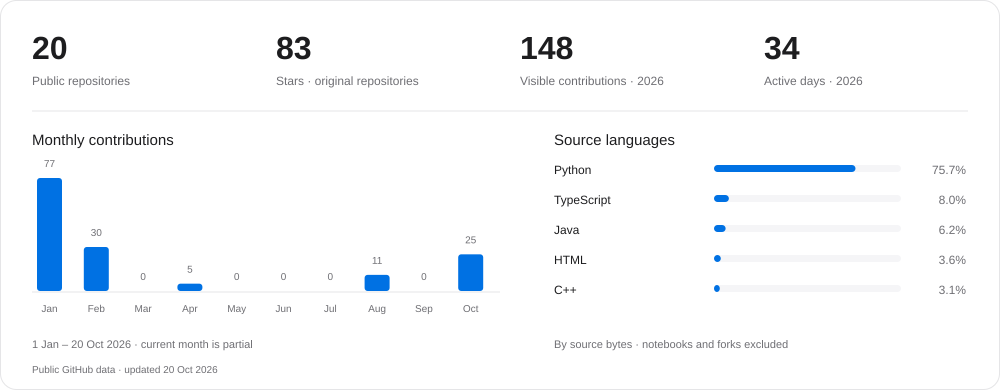

# Prabal Pratap Singh

First Class MEng(4 yr Full Time) in Computer Science, University of Birmingham.

I build desktop applications, web products, and systems software. My projects range from financial dashboards and client–server applications to Python/C++ engines and machine-learning experiments. I care about clear interfaces, understandable code, and checking that things work. my focus extends to building practical open-source utilities and templates that help other developers build faster. 

## 1. Selected projects

| Project | What I worked on | Area |
|---|---|---|
| [TradeLens](https://github.com/prblydv/tradelens) | A Windows application that connects to MetaTrader 5 for read-only trade-risk analysis | Desktop software · Python |
| [MoneyMaven](https://github.com/prblydv/Finance-Tracking-MoneyMaven) | A team project for tracking income, expenses, and budgets with Angular, Spring Boot, and PostgreSQL | Full-stack development |
| [pokerCFR](https://github.com/prblydv/pokerCFR) | Python and C++ game engines, resumable training, evaluation tools, and a desktop GUI | Systems · C++ · Python |
| [TCP client–server application](https://github.com/prblydv/implementing_client_server_app_TCP) | A Java application connecting multiple clients to a database-backed server using TCP and JDBC | Backend · Networking · SQL |
| [Multimodal video classification](https://github.com/prblydv/Hate-Detection-Video-MultiModaL-DeepL) | A research project combining text, audio, and visual features for hate-speech detection | Machine learning |

More research work: [time-series forecasting](https://github.com/prblydv/Forex-Market-Prediction-DeepL) and [LLM preference classification](https://github.com/prblydv/llm-classification-finetuning).

## 2. How I work

1. Understand the problem and start with a small, working version.
2. Build clear interfaces between components and check the important behaviour.
3. Investigate failures, document decisions, and improve the implementation.
4. Review the implementation, check the results, and keep the code understandable.

## 3. Skills and background

| Area | Technologies |
|---|---|
| Languages | Python, Java, C++, C, TypeScript, SQL |
| Web and backend | Angular, React, Spring Boot, Node.js, Flask, PostgreSQL |
| Development | Git, Docker, Linux, Jupyter |
| Machine learning | PyTorch, Hugging Face, scikit-learn |

## 4. GitHub activity

Activity is year to date, as shown in the graphic. Language shares measure source bytes in original public repositories, excluding notebooks. Counts reflect publicly visible GitHub data.

## 5. Contact

[Email](mailto:yadavsk731@gmail.com) · [LinkedIn](https://www.linkedin.com/in/prabalsingh12/) · [LeetCode](https://leetcode.com/u/prblydv/)
