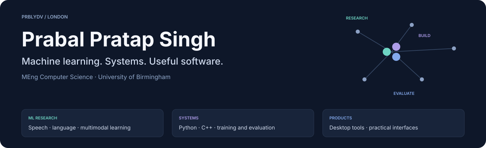
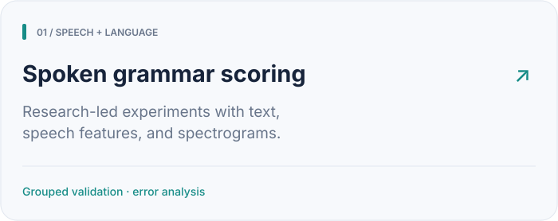
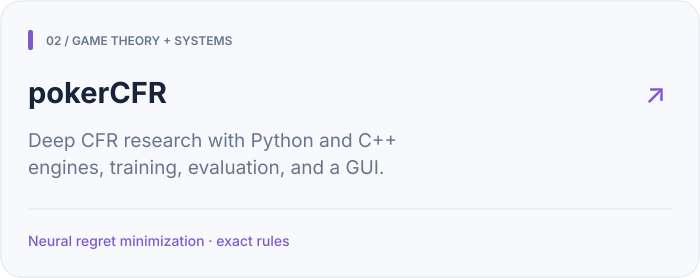
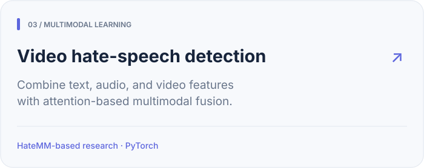
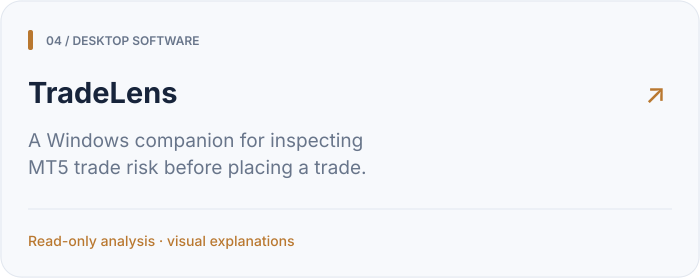
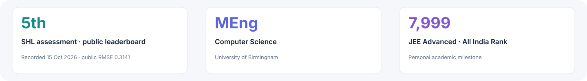

## 1. About me

I’m **Prabal**, a software engineer based in London with an **MEng in Computer Science from the University of Birmingham**. I build machine-learning experiments, training systems, and practical applications.

My work spans speech and language models, multimodal learning, game theory, and desktop software. I enjoy understanding an idea, testing its limits, and turning it into something people can inspect or use.

## 2. Selected work

Click a card to explore the code, design choices, and results.

<table>
  <tr>
    <td width="50%"></td>
    <td width="50%"></td>
  </tr>
  <tr>
    <td width="50%"></td>
    <td width="50%"></td>
  </tr>
</table>

Other explorations include [physics-informed neural networks](https://github.com/prblydv/torchpinn), [time-series forecasting](https://github.com/prblydv/Forex-Market-Prediction-DeepL), [LLM preference classification](https://github.com/prblydv/llm-classification-finetuning), and [evolutionary optimization](https://github.com/prblydv/Solving-TSP-with-Evolutionary-Algorithms).

## 3. Milestones

1. **SHL grammar-scoring assessment:** recorded **5th place** on the public Kaggle leaderboard, with **0.3141 public RMSE**, at the saved **15 October 2026** snapshot. The [project report](https://github.com/prblydv/shl-grammar-scoring) explains the method, development scores, and generalization limits. This is a historical public result; the private score is unknown.
2. **MEng Computer Science**, University of Birmingham.
3. **JEE Advanced: All India Rank 7,999.** An early milestone that helped build my interest in difficult technical problems.

## 4. How I work

1. **Research first.** Read related papers and earlier competition solutions, then turn useful ideas into testable hypotheses.
2. **Build a baseline.** Start with a simple approach that is easy to understand and compare against.
3. **Inspect the failures.** Check the data, validation splits, and errors before adding model complexity.
4. **Keep the work explainable.** Record settings, unsuccessful experiments, and what the evidence does and does not support.
5. **Use AI tools thoughtfully.** Codex is part of my development workflow. I focus on understanding the approach, checking the implementation, and being able to explain the result.

## 5. Tools I use

| Area | Tools |
|---|---|
| Machine learning | PyTorch, Hugging Face, scikit-learn, TensorFlow, OpenCV |
| Languages and systems | Python, C++, C, SQL, Linux |
| Applications | React, TypeScript, Node.js, Flask |
| Development | Git, Docker, Jupyter, Codex |

## 6. Get in touch

I’m interested in conversations about research engineering, machine learning, and building useful software.

1. **Email:** [yadavsk731@gmail.com](mailto:yadavsk731@gmail.com)
2. **LinkedIn:** [prabalsingh12](https://www.linkedin.com/in/prabalsingh12/)
3. **LeetCode:** [prblydv](https://leetcode.com/u/prblydv/)

Profile refreshed on 15 October 2026. Project results are linked to their original context.
